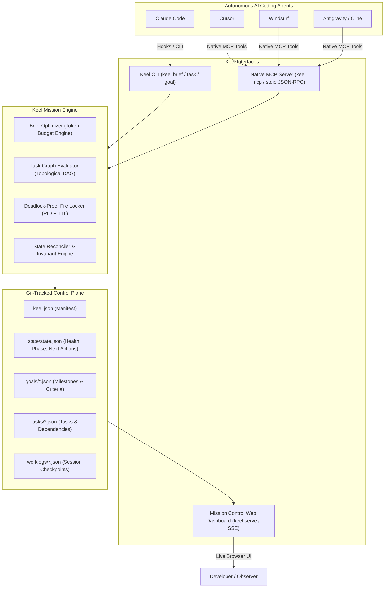
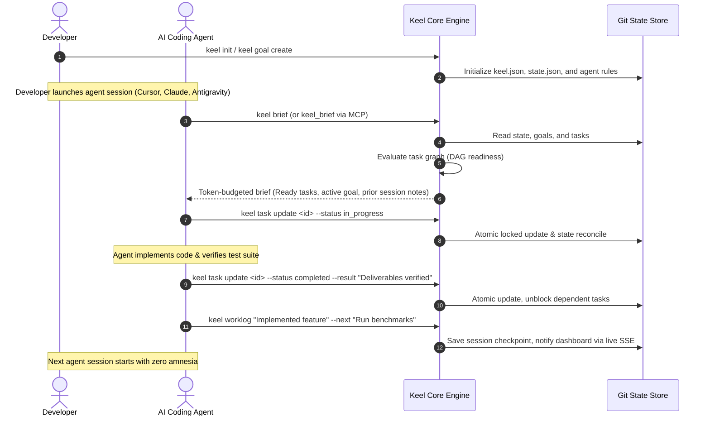

<div align="center">

# ⚓ Keel

**The persistent, cross-platform mission control for autonomous coding agents.**

*Every new agent session starts from zero. With Keel, yours don't.*

[](go.mod)
[](LICENSE)
[](#)
[](#native-mcp-integration)

</div>

---

## Architecture & System Overview

Keel maintains a lightweight, Git-backed control plane for your project, bridging independent agent harnesses into a single synchronized mission control.



---

## Agent Session Lifecycle Workflow



---

## Why Keel?

If you work with coding agents (Claude Code, Cursor, Codex, Windsurf, Antigravity) across multi-turn sessions, you encounter the same friction points:

- **Context amnesia:** A fresh agent session starts blind. You spend valuable tokens and time re-explaining the goal, recent decisions, and half-finished work.
- **Tool fragmentation:** What you built in Cursor yesterday is invisible to Claude Code or Antigravity today.
- **Hallucinated direction:** Parallel agents wander off track without an explicit dependency graph of what is ready, blocked, or in-flight.

**Keel** solves this by maintaining a lightweight, Git-backed control plane for your project. It gives every agent session an instant, context-compressed **brief**, an actionable **task DAG**, and a shared **worklog** across tools.

---

## Key Features

- **🚀 Token-Compressed Brief:** `keel brief` generates a dense, token-budgeted summary (~250-400 tokens) giving agents instant orientation at session start.
- **🔌 Native MCP Server:** Run `keel mcp` to connect directly to **Cursor**, **Claude Desktop**, **Windsurf**, or **Antigravity** via standard JSON-RPC 2.0 without fragile shell hacks.
- **⚡ Real-Time Reactive Dashboard:** Run `keel serve` to open an embedded mission control UI with live Server-Sent Events (SSE). Watch tasks update in real time as agents work.
- **🛡️ 100% Cross-Platform & Resilient:** Engineered for Windows, macOS, and Linux. No symlink privilege crashes on Windows; deadlock-free file locking with automatic PID liveness checks and TTL expiration.
- **🔒 Secure by Design:** Localhost-only binding with defensive CSP, X-Frame-Options, and restricted CORS.
- **📦 Single Static Binary:** Built entirely with Go standard library primitives. Zero external runtime dependencies.

---

## Quick Start

### 1. Build & Install
```bash
go build -o keel.exe ./cmd/keel
```

### 2. Initialize a Project
Run `keel init` inside your project directory:
```bash
keel init --name "My Project" --desc "Autonomous agent project memory"
```

This sets up:
* `keel.json` - Root project manifest
* `goals/` - Target outcomes and milestone conditions
* `tasks/` - Actionable task graph with dependencies
* `state/` - Current control-plane snapshot (phase, health, next actions)
* `worklogs/` - Session records and agent handoffs
* `AGENTS.md` & `CLAUDE.md` & `.cursor/rules/keel.mdc` - Pre-configured agent instructions

---

## Core Workflow & CLI Guide

### At Session Start
Agents (or developers) run:
```bash
keel brief
```
```markdown
# Keel Project Brief: Checkout Revamp
**Status:** ● [On Track] | **Phase:** Implementation
**Progress:** 4 of 6 tasks completed (66%)

## Current Goal: Cut checkout latency
> Reduce checkout time to under 2 seconds

## Actionable Work (Ready Tasks)
- **`task-payment`** [CRITICAL]: Parallelize Stripe Gateway Call

## In-Progress Tasks
- ⏳ **`task-auth`**: Optimize Auth Token Verification (assigned to claude-code)

## Recommended Next Steps
1. Execute task task-payment: Parallelize Stripe Gateway Call
```

### Managing Goals
```bash
# Create a high-level outcome
keel goal create --id speed-checkout --title "Cut checkout latency" --outcome "Sub-2 second checkout"

# List and inspect goals
keel goal list
keel goal get speed-checkout

# Set active project goal
keel goal select speed-checkout

# Update or delete goals
keel goal update speed-checkout --outcome "Sub-1.5 second checkout"
keel goal delete speed-checkout
```

### Managing Tasks
```bash
# Create tasks with dependencies and priorities
keel task create --id task-api --title "Implement REST API" --priority high
keel task create --id task-ui --title "Build React View" --depends task-api

# Check which tasks are unblocked and ready to execute
keel task ready

# Filter task list
keel task list --status ready
keel task list --status blocked

# Mark progress
keel task update task-api --status in_progress --assignee claude

# Mark completed with deliverables
keel task update task-api --status completed --result "Endpoints live on port 8080"

# Delete a task
keel task delete task-ui
```

### Session Checkpoint (Before Leaving)
Before finishing, the agent leaves structured notes for the next session:
```bash
keel worklog "Implemented auth token caching in Redis" --next "Run benchmark tests, Wire Stripe webhook"
```

### Project Health Audit
```bash
keel doctor
```

---

## Native MCP Integration

Keel includes a native **Model Context Protocol (MCP)** server (`keel-memory`). Instead of agents executing shell commands, they can call Keel tools directly within their native tool-use interface.

### Cursor Configuration (`~/.cursor/mcp.json`)
```json
{
  "mcpServers": {
    "keel-memory": {
      "command": "keel",
      "args": ["mcp"]
    }
  }
}
```

### Claude Desktop Configuration (`claude_desktop_config.json`)
```json
{
  "mcpServers": {
    "keel-memory": {
      "command": "keel",
      "args": ["mcp"]
    }
  }
}
```

### Available MCP Tools:
* `keel_brief` — Fetch the latest orientation, goals, and active tasks.
* `keel_task_list` — List tasks filtered by status (`ready`, `in_progress`, `blocked`, `completed`).
* `keel_task_create` — Create tasks with priorities and dependency constraints.
* `keel_task_update` — Update a task's status, deliverables, or blocker reason.
* `keel_task_delete` — Delete a task from the project.
* `keel_goal_create` — Define new project goals and milestones.
* `keel_goal_list` — List all registered goals.
* `keel_goal_update` — Update goal status and criteria.
* `keel_worklog_record` — Record a session checkpoint and next steps for subsequent agents.

---

## Live Mission Control Dashboard

Launch the embedded reactive web UI:
```bash
keel serve --port 7788
```
Open `http://localhost:7788` to see real-time task cards, project health, goals, and session logs streaming live via Server-Sent Events (SSE).

---

## License

MIT License © 2026 Tejas
